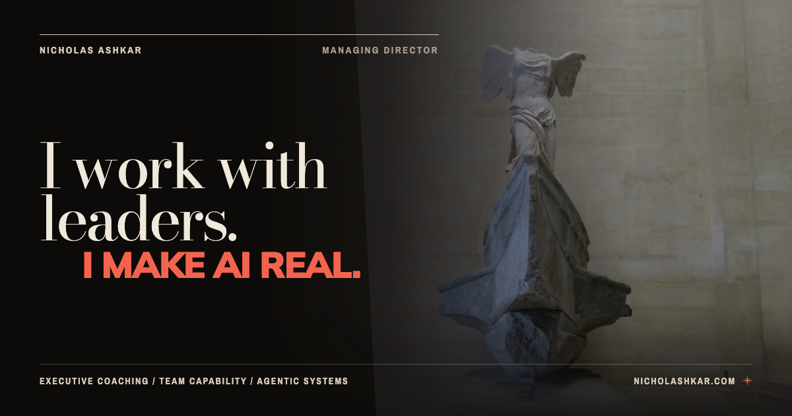

# Nicholas Ashkar

**AI engineering and automation consultant.** I work with leaders. I make AI real.

I work with leaders on leadership effectiveness, team capability, and applied AI. I'm a Managing Director and the founder of [Cirvgreen](https://cirvgreen.com).

For prospective clients and collaborators, these repositories are the inspectable software side of my work. My portfolio brings together the broader experience, selected cases, and ways to work with me.

[Discuss a project](https://nicholashkar.com/#oxblood-contact) · [Explore my work](https://nicholashkar.com) · [Browse the repositories](https://github.com/NickCirv?tab=repositories)

---

## Flagship: engram

 · [`engramx` on npm](https://www.npmjs.com/package/engramx) · Apache-2.0

Context infrastructure for AI coding tools. Structural code maps and local memory help agents find relevant code and retain lessons across sessions. Local SQLite, no cloud dependency.

One dated run of the project's own harness recorded an 89.1% aggregate token reduction across an 87-file codebase ([result log](https://github.com/NickCirv/engram/blob/main/bench/results/real-world-2026-04-24.md)). Read the [benchmark documentation](https://github.com/NickCirv/engram/blob/main/bench/README.md) before relying on that figure: it states which values are simulated and what each harness does and does not measure.

[Read the project](https://github.com/NickCirv/engram#readme) · [Installation](https://github.com/NickCirv/engram/blob/main/docs/install.html)

## Serious tools

| Repository | What it does |
| --- | --- |
| [engram-counter](https://github.com/NickCirv/engram-counter) | The audit primitive behind engram's savings claims: tamper-evident, JCS-canonicalized SHA-256 attestations over paired-run token logs. |
| [cirv-accessibility-index](https://github.com/NickCirv/cirv-accessibility-index) | Open WCAG and EAA compliance index for EU e-commerce: crawler, SQLite dataset, and a self-publishing directory. |
| [cursor-to-claude](https://github.com/NickCirv/cursor-to-claude) | CLI that migrates Cursor, Copilot, Windsurf, or Cline settings to Claude Code. No API key or account required. |
| [robots-txt-audit](https://github.com/NickCirv/robots-txt-audit) | Audits a site's robots.txt: flags blocking mistakes, scores quality, and reports AI crawler visibility. Zero dependencies. |
| [dep-doctor](https://github.com/NickCirv/dep-doctor) | Node.js dependency health in one CLI run: outdated, vulnerable, unused, and duplicate packages, scored and prioritized. |
| [wp-plugin-health](https://github.com/NickCirv/wp-plugin-health) | CLI health checker for WordPress plugins: 15 quality signals rolled into a 0 to 100 score. Zero dependencies. |

Start with each repository's purpose, source-backed usage and limitations. Some projects are experiments, and archived repositories remain historical references.

### [Cirvgreen](https://cirvgreen.com)

WordPress products for structured data, accessibility, site monitoring, and cookie consent. Explore the product documentation for each tool's scope and limitations.

[Cirv Box](https://wordpress.org/plugins/cirv-box/) · [Cirv Guard](https://wordpress.org/plugins/cirv-guard/) · [Cirv Pulse](https://wordpress.org/plugins/cirv-pulse/) · [Cirv Comply](https://wordpress.org/plugins/cirv-comply/)

---

## Work with me

I take on consulting engagements in AI engineering, automation, and web work. Share the problem, your constraints, and what a useful outcome would look like.

**[Discuss a project](https://nicholashkar.com/#oxblood-contact)**

- **Experience and fit:** [background and selected work](https://nicholashkar.com/#oxblood-about).
- **Open-source contributors:** start with a project's README, contribution guidance, and open issues.

---

[nicholashkar.com](https://nicholashkar.com) · [Cirvgreen](https://cirvgreen.com) · [All repositories](https://github.com/NickCirv?tab=repositories)

## Documentation notes

[Source review and editorial scope](docs/RESEARCH.md) records the profile baseline and distinguishes project evidence from biography and product descriptions.

[Recommended pins](docs/PINS.md) records which six repositories to pin and why.

[Artwork credits](assets/nicholas-ashkar/CREDITS.md)
